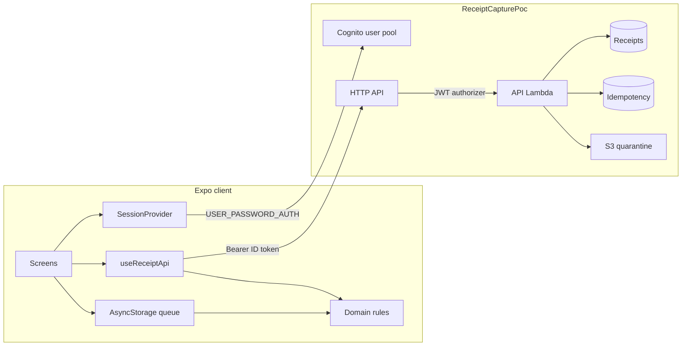

# Receipt capture

Synthetic receipt-capture proof of concept. A reviewer can sign in as a seeded company, capture a receipt, queue it offline, and see **Confirmed** only after the server accepts it. A retry does not create a second receipt. Switching company cannot upload the other company's queue.

This is not a product. There is no employer code, customer data, or live card data in this repo.

## Architecture

The phone signs in with Cognito, then calls the HTTP API with the ID token. The API reads `custom:company_id` and keeps each company's receipts separate. When the phone is offline, or the API cannot be reached, the same domain rules run on the device and store a local fake. Logout clears that device copy. The next sign-in loads the company list from DynamoDB.



| Layer | What it uses |
| --- | --- |
| Client | Expo 57, expo-router, React 19, React Native 0.86, TypeScript 5.8 |
| Sign-in | Cognito user pool, `USER_PASSWORD_AUTH`, no hosted UI. `custom:company_id` on the user. Tokens in expo-secure-store. |
| Device copy | AsyncStorage for receipt metadata. A banner is green when the device has a network and red when it does not. Image bytes and tokens are not stored there. |
| Domain | TypeScript in `src/domain/`. Node 22 tests. Money is integer minor units. Dates are `MM-DD-YYYY`. |
| API | API Gateway HTTP API. JWT authorizer checks the ID token audience. One Lambda, Node.js 24. |
| Data | DynamoDB on demand. Receipts keyed by `companyId` and `receiptId`. Idempotency keyed by `companyId` and `idempotencyKey`. |
| Images | Private S3 bucket, blocked public access, SSE-S3. The Lambda can put an optional image. GET does not return the bytes. |
| Deploy | AWS CDK 2. Stack name `ReceiptCapturePoc`. Account and region come from the CDK environment. A custom resource seeds the two demo users. Log groups keep one week. |

Deploy and destroy from [infra/README.md](infra/README.md).

## Time box

Started 2026-10-29. Spec 001, the plan that shipped, is [.spec/001-initial-poc.md](.spec/001-initial-poc.md). Spec 002, the UX plan, is [.spec/002-ux.md](.spec/002-ux.md). Decisions are in [DECISIONS.md](DECISIONS.md).

## Status

| Piece | State |
| --- | --- |
| README and decision log | Published with issue 1. |
| Money and dates | Issue 2. Integer minor units. Dates are `MM-DD-YYYY`. |
| Receipt state machine | Issue 3. Queue acceptance is `Queued`. `Confirmed` only from a server accept or a user correction. |
| Idempotency and company switch | Issue 4. A lost success returns the same receipt. Another company's key is rejected. Logout clears the queue. |
| Matching | Issue 5. Exact currency and minor units, then merchant similarity. One transaction cannot take two receipts. A late processor result does not overwrite a user correction. |
| Expo sign-in | Issue 6. In-app Cognito password sign-in. Tokens in SecureStore. Logout clears the queue. |
| Receipt form | Issue 7. Merchant, amount, currency, `MM-DD-YYYY` date, and a synthetic image. The screen shows every state and does not mark Confirmed. |
| Offline queue | Issue 8. An offline toggle. Receipt metadata stays on the device and reloads after relaunch. Tokens and image bytes are not in that store. |
| API submit | Issue 10. `POST /receipts` with `Idempotency-Key`. A lost success returns the same receipt. A local fake covers `npx expo start` when AWS is down. |
| Match correction | Issue 11. A NeedsReview receipt lists open transactions. Confirm match sets Confirmed from that choice. One transaction cannot take two receipts. A later processor result leaves the correction in place. |
| AWS stack | Issue 9. `ReceiptCapturePoc` in `infra/`. Deploy and destroy from that folder. Cleanup is `infra/CLEANUP.md`. |
| Spec 001 | Complete. Archived in [.spec/001-initial-poc.md](.spec/001-initial-poc.md). |
| Spec 002 | [.spec/002-ux.md](.spec/002-ux.md). Issues 26–30. |
| Home list | Issue 26. After sign-in, the screen lists that company's receipts from `GET /receipts`, with merchant, amount, date, and status. |
| Connectivity banner | Issue 27. The Offline switch is gone. The banner is green online and red offline. A returning network does not submit. |

## Run the tests

Requires Node.js 22.18 or newer.

```bash
npm install
npm test
npm run typecheck
```

The app is in `mobile/`:

```bash
cd mobile
cp env.example .env
npm install
npx expo start --ios
```

`--ios` opens the installed iOS Simulator. The banner under the status bar is green while the Mac has a network and red when it does not. Until `.env` has Cognito values, choose **Preview form as northwind**. That preview does not call Cognito. Save a draft and queue it. With the banner green, queue sends the receipt to the API. With the banner red, queue uses the local fake. Turning the network back on does not send that receipt again. Stop Expo, start it again, and choose the same preview. The queue comes back. Log out clears that company's queue.

Put the region, user pool id, app client id, and API URL from the `ReceiptCapturePoc` stack outputs into `.env`. Seeded usernames and passwords are in [infra/README.md](infra/README.md). Deploy and tear down from `receipt-capture/infra`. With no API URL, or when the API cannot be reached, **Queue receipt** uses the local fake. A lost success retries that same key and keeps the same receipt id.

## Companies

Two synthetic companies, decided up front so later issues do not drift:

- `northwind` — user `northwind.demo`
- `contoso` — user `contoso.demo`

Passwords, for when the stack is deployed:

| Username | Password | Company |
| --- | --- | --- |
| `northwind.demo` | `Northwind-demo-1` | `northwind` |
| `contoso.demo` | `Contoso-demo-1` | `contoso` |

They are demo passwords, not personal secrets.

## AI tools

Cursor, with Grok 4.7, drafted the repo layout, domain module, CDK stack, and these notes. The domain rules were checked with `npm test` from this folder. The API rule copy was checked with `npm test` inside `infra/`. Nothing from an employer repository was copied. Deploy and tear down from `receipt-capture/infra`.
