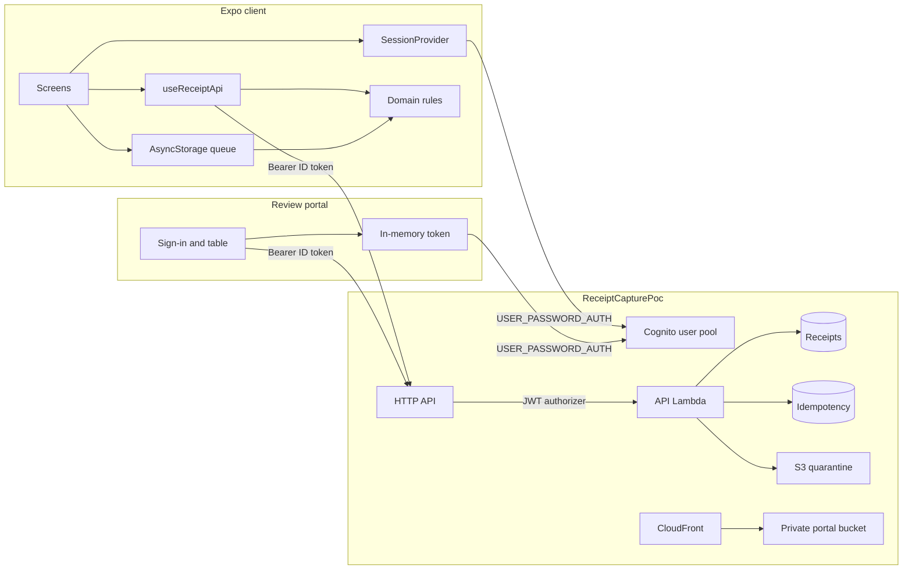

# Receipt capture

Synthetic receipt-capture proof of concept. A reviewer can sign in as a seeded company, capture a receipt, queue it offline, and see **Confirmed** only after the server accepts it. A retry does not create a second receipt. Switching company cannot upload the other company's queue.

This is not a product. There is no employer code, customer data, or live card data in this repo.

## Architecture

The phone signs in with Cognito, then calls the HTTP API with the ID token. The API reads `custom:company_id` and keeps each company's receipts separate. When the phone is offline, or the API cannot be reached, the same domain rules run on the device and store a local fake. Logout clears that device copy. The next sign-in loads the company list from DynamoDB.



| Layer | What it uses |
| --- | --- |
| Client | Expo 57, expo-router, expo-image-picker, React 19, React Native 0.86, TypeScript 5.8 |
| Sign-in | Cognito user pool, `USER_PASSWORD_AUTH`, no hosted UI. `custom:company_id` on the user. Tokens in expo-secure-store. |
| Device copy | AsyncStorage for receipt metadata. A banner is green when the device has a network and red when it does not. Image bytes and tokens are not stored there. |
| Domain | TypeScript in `src/domain/`. Node 22 tests. Money is integer minor units. Dates are `MM-DD-YYYY`. |
| API | API Gateway HTTP API. JWT authorizer checks the ID token audience. One Lambda, Node.js 24. |
| Data | DynamoDB on demand. Receipts keyed by `companyId` and `receiptId`. Idempotency keyed by `companyId` and `idempotencyKey`. |
| Images | Private S3 bucket, blocked public access, SSE-S3. The Lambda can put an optional image. GET does not return the bytes. |
| Review portal | Vite, React 19, and TypeScript in `portal/`. Same Cognito password sign-in. The ID token stays in memory for the tab. |
| Site | CloudFront Price Class 100 serves the portal over HTTPS. The bucket blocks direct public reads. Origin access control is the only reader. |
| Deploy | AWS CDK 2. Stack name `ReceiptCapturePoc`. Account and region come from the CDK environment. A custom resource seeds the two demo users. Log groups keep one week. |

Deploy and destroy from [infra/README.md](infra/README.md).

## Time box

Started 2026-10-29. Spec 001, the plan that shipped, is [.spec/001-initial-poc.md](.spec/001-initial-poc.md). Spec 002, the UX plan, is [.spec/002-ux.md](.spec/002-ux.md). Decisions are in [DECISIONS.md](DECISIONS.md).

## Status

| Piece | State |
| --- | --- |
| README and decision log | Published with issue 1. |
| Money and dates | Issue 2. Integer minor units. Dates are `MM-DD-YYYY`. |
| Receipt state machine | Issue 3. Queue acceptance is `Queued`. `Confirmed` only from a server accept or a user correction. |
| Idempotency and company switch | Issue 4. A lost success returns the same receipt. Another company's key is rejected. Logout clears the queue. |
| Matching | Issue 5. Exact currency and minor units, then merchant similarity. One transaction cannot take two receipts. A late processor result does not overwrite a user correction. |
| Expo sign-in | Issue 6. In-app Cognito password sign-in. Tokens in SecureStore. Logout clears the queue. |
| Receipt form | Issue 7. Merchant, amount, currency, `MM-DD-YYYY` date, and a synthetic image. The screen shows every state and does not mark Confirmed. |
| Offline queue | Issue 8. An offline toggle. Receipt metadata stays on the device and reloads after relaunch. Tokens and image bytes are not in that store. |
| API submit | Issue 10. `POST /receipts` with `Idempotency-Key`. A lost success returns the same receipt. A local fake covers `npx expo start` when AWS is down. |
| Match correction | Issue 11. A NeedsReview receipt lists open transactions. Confirm match sets Confirmed from that choice. One transaction cannot take two receipts. A later processor result leaves the correction in place. |
| AWS stack | Issue 9. `ReceiptCapturePoc` in `infra/`. Deploy and destroy from that folder. Cleanup is `infra/CLEANUP.md`. |
| Spec 001 | Complete. Archived in [.spec/001-initial-poc.md](.spec/001-initial-poc.md). |
| Spec 002 | [.spec/002-ux.md](.spec/002-ux.md). Issues 26–30. |
| Home list | Issue 26. After sign-in, the screen lists that company's receipts from `GET /receipts`, with merchant, amount, date, and status. |
| Connectivity banner | Issue 27. The Offline switch is gone. The banner is green online and red offline. A returning network does not submit. |
| Capture entry | Issue 28. Home, a green Capture button, and Profile sit on a bottom menu. Capture opens the camera or the photo library. Profile shows the company and Log out. A photo stays in memory and is sent only when online and under 500 KB. |

## Testing

The test plan is [docs/test-plan.md](docs/test-plan.md). It lists the assignment outcomes, the receipt state diagram, and the checks already in this repo.

Requires Node.js 22.18 or newer.

```bash
npm install
npm ci --prefix infra
npm ci --prefix portal
npm run test:all
```

`npm run test:all` runs the domain tests, the typecheck, the API rule tests, and the portal typecheck. It prints how many of those four commands passed and exits non-zero if one fails. Pull requests run the same command in GitHub Actions.

The simulator walk is separate. Install Maestro with `curl -Ls "https://get.maestro.mobile.dev" | bash` and a JDK with `brew install openjdk@21`. Set `EXPO_PUBLIC_SHOW_FAKE_RECEIPTS=1` in `mobile/.env` and restart Expo. With the app open from `npm run ios`, run `npm run record:simulator`. That clears the receipt tables, then signs in as northwind and checks a 100% match (Blue Bottle at 18.50 USD), an 80% match (Harbor Grill at 24.00 USD), a NeedsReview match (City Parking at 22.00 USD, left unmatched), a failed upload with Retry, and a contoso sign-in that cannot see the northwind receipts. The passing walk is [maestro/recordings/walk-20261030-092153.mov](maestro/recordings/walk-20261030-092153.mov). Opening that file on GitHub plays the video. A later run writes an mp4 under `maestro/recordings/`. Commit that file after a green run. `npm run clear:receipts` clears the tables without recording.

## Run locally

Needs a Mac with Xcode and the iOS Simulator. Commands below are from this folder after you clone the repo.

1. Install the app and copy the env file.

```bash
npm install
npm --prefix mobile install
cp mobile/env.example mobile/.env
```

2. Put the Cognito region, user pool id, app client id, and API URL from the `ReceiptCapturePoc` stack into `mobile/.env`. Usernames and passwords are in [infra/README.md](infra/README.md). Deploy and tear down from `receipt-capture/infra`. If those values are empty, the sign-in screen offers **Preview form as northwind** and does not call Cognito.

3. Start Expo and open the simulator.

```bash
npm run ios
```

4. In a second terminal, with that simulator still open, load the pictures from `mobile/assets/fake-receipts/` into the simulator photo library.

```bash
npm run seed:photos
```

That folder already has cafe, fuel, and office. Add any other PNG or JPEG there and run `npm run seed:photos` again. The script sends every picture in the folder to the booted simulator.

5. In the app, sign in. On a phone, **Capture** opens the camera. In the simulator there is no camera, so **Capture** stays on this screen and you use **Tap to choose from library**. That library now includes the seeded receipts. **Profile** shows the company name and **Log out**.

If seeding fails, set `EXPO_PUBLIC_SHOW_FAKE_RECEIPTS=1` in `mobile/.env` and restart Expo. **Capture** then shows **Use a fake receipt** for cafe, fuel, and office. Leave that variable unset and those buttons stay hidden.

The banner under the status bar is green while the Mac has a network and red when it does not. With the banner green, **Submit** sends the receipt to the API. With the banner red, **Queue receipt** keeps it on the device. Turning the network back on submits that queued receipt. A lost success retries the same key and keeps the same receipt id. Notes are optional.

## Review portal

The deployed site is [https://dyn2tqabuofe2.cloudfront.net](https://dyn2tqabuofe2.cloudfront.net).

The portal lists receipts the phone already submitted. It does not create a receipt, edit merchant, amount, currency, or date, or delete a row. A NeedsReview receipt can confirm one open match. A Failed receipt can retry. The page copies Confirmed from the API response. The user icon in the top bar shows the company for the current session. **Log out** is in that menu.

### Run locally

From this folder, after you clone the repo:

1. Install the portal and copy the config file.

```bash
npm ci --prefix portal
cp portal/config.example.json portal/public/config.json
```

2. Fill `portal/public/config.json` with the region, user pool id, app client id, and API URL from the `ReceiptCapturePoc` stack outputs. That file stays off git. Usernames and passwords are in [infra/README.md](infra/README.md).

3. Start the dev server.

```bash
npm run dev --prefix portal
```

4. Open the local URL Vite prints. Sign in with the same demo user as the phone.

### Deployed site

Open [https://dyn2tqabuofe2.cloudfront.net](https://dyn2tqabuofe2.cloudfront.net). CloudFront serves the static files over HTTPS on that address. The S3 bucket stays closed to direct public reads. Anyone can open the sign-in page. Receipts still require the company sign-in.

From `infra/`, `npm run deploy` rebuilds `portal/` and updates that site. The stack output `PortalUrl` is the same address. Tear down is `npm run destroy` from `infra/`.

## Companies

Two synthetic companies, decided up front so later issues do not drift:

- `northwind` — user `northwind.demo`
- `contoso` — user `contoso.demo`

Passwords, for when the stack is deployed:

| Username | Password | Company |
| --- | --- | --- |
| `northwind.demo` | `Northwind-demo-1` | `northwind` |
| `contoso.demo` | `Contoso-demo-1` | `contoso` |

They are demo passwords, not personal secrets.

## Seeded transactions

The fake processor matches the merchant, amount, and currency you type against this list. The photo is stored and is not read. Run this from the repo root to print the same list the API uses:

```bash
npm run seeds
```

| Company | Transaction | Merchant | Amount |
| --- | --- | --- | --- |
| `northwind` | `txn-blue-bottle` | Blue Bottle | 18.50 USD |
| `northwind` | `txn-harbor` | Harbor | 24.00 USD |
| `northwind` | `txn-parking` | Airport Parking | 22.00 USD |
| `contoso` | `txn-contoso-cafe` | Contoso Cafe | 9.75 USD |

The amount and currency must match a seed for that company. The receipt list shows that score as a decimal and a percent, such as `0.80 (80%)`. A merchant score of 0.8 or higher comes back **Confirmed**. An equal name scores 1. A name that contains the other scores 0.8, so **Harbor Grill** at 24.00 USD confirms against Harbor. **Blue Bottle Coffee** at 18.50 USD also scores 0.8 against Blue Bottle while that transaction is still open. After Blue Bottle confirms, that transaction is taken, and a later Blue Bottle Coffee receipt at the same amount comes back **NeedsReview** at `0.00 (0%)`. A shared word below 0.8 comes back **NeedsReview**. **City Parking** at 22.00 USD shares "parking" with Airport Parking, so you confirm that seed or leave the receipt unmatched. A different amount, such as Northwind Cafe at 12.34 USD, comes back **NeedsReview** with nothing to pick. One transaction cannot take two receipts. The date and the notes do not change the result. The local fake uses this same list when the API cannot be reached.

Merchant **Fail Upload** is not a transaction. The first submit stays on the form as **Failed**, with no score. A toast says **Upload failed. Try again.** **Retry** sends that same receipt through the processor. It then comes back **NeedsReview** at `0.00 (0%)`.

## AI tools

Cursor, with Grok 4.7, drafted the repo layout, domain module, CDK stack, and these notes. The domain rules were checked with `npm test` from this folder. The API rule copy was checked with `npm test` inside `infra/`. Nothing from an employer repository was copied. Deploy and tear down from `receipt-capture/infra`.
